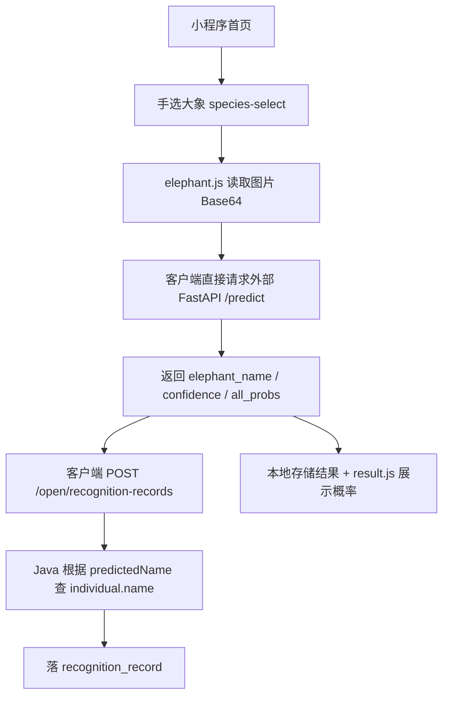
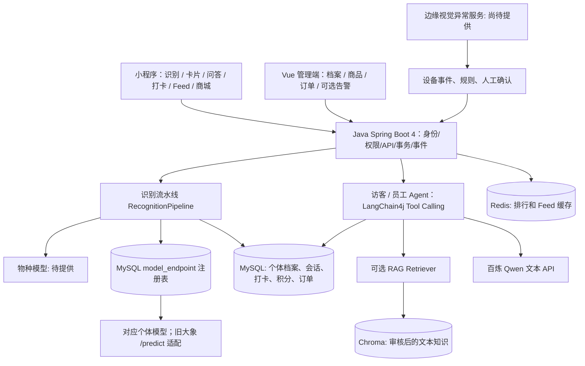

# CL-recognized / 长隆之家：源码核对后的完整升级实施方案 v2.0

> **日期**：2026-11-06  
> **核对对象**：用户上传的 `elephantJava (2).zip`（内含 Java 后端、Vue 管理端、微信小程序，以及 `/docs` 中的两份原始需求方案）。  
> **结论**：上一版 v0.1 需要明显修改。以下方案根据实际文件重新排序、细化，但**没有接入运行中的 MySQL、外部 FastAPI 识别服务、微信授权环境或百炼账号；没有改动原始仓库**。新增表、接口、代码类名是“待实现建议”，不能说已经存在。  
> **阅读顺序**：本文件 → `02_code_audit.md` → `03_api_contracts.md` → `04_mysql_migration_DRAFT.sql` → `05_backlog_acceptance.md`。

---

## 0. 先给项目组的结论：到底应该做什么？

这个项目的目标不是“把动物资料统统塞入 Chroma，然后让大模型识别图片”。正确目标是让现有的“单物种识别演示”逐步变成**可信的动物个体识别与互动服务**：

1. **识别主链路**：小程序上传照片 → Java 后端发起识别 → 先确定物种、再按注册表找到对应个体模型 → 根据返回的稳定编号查询 MySQL → 返回动物卡片。
2. **访客 AI 助手**：用户看到卡片后自然语言追问。短字段（年龄、性别、状态）走数据库工具；有足够已审核长文时，才调用 RAG/Chroma 找观察故事、行为特征、科普说明；最后由百炼 Qwen 组织回答。
3. **物种打卡讨论**：经服务端验证的识别成功后，游客对该物种当日首次打卡，记录排行与积分。仅当天打过该物种卡的用户能进入该物种当天的讨论 Feed。
4. **积分商城**：可查余额、查看积分商品、消耗积分兑换；以 MySQL 事务、唯一键、条件更新保证不重复发分、不会欠积分、不会超卖。特价商品可进一步使用 Redisson 锁削峰。
5. **管理端异常辅助（独立扩展线）**：在**另行提供边缘视觉异常识别系统的真实输出**后，Java 接收设备事件、规则分级和去重；工作人员 Agent 仅负责解释与交班，不能自行“看图诊断”。

**首个能演示的最小闭环**：用户上传大象照片 → Java 调用原有 `/predict` → 查到准确 `individual` → 小程序显示姓名、头像、年龄依据与简介 → 点击提问，百炼工具查询 MySQL 回答。先把这条链路做到完整、可测试，再做扩展。

### 新旧方案的决定性区别

| 上一版 v0.1 的假设 | 上传源码与两份需求的实际情况 | v2.0 调整 |
| --- | --- | --- |
| 原系统可能已经识别并返回稳定动物 ID | 目前 Python 图片接口返回 `elephant_name`、`confidence`、`all_probs`；客户端转发给 Java，Java**按名称**关联 `individual` | 增加模型适配器、业务 ID 绑定；不能把模型显示名当主键 |
| RAG 是卡片查询主路径 | `individual` 已有短结构化档案，原 Agent 需求明确“Tool Calling 先行、RAG 可延期” | **卡片直接查 MySQL**；RAG 是已审核长文的补充功能 |
| 只有简单的 AI 卡片和积分社区 | `/docs` 还要求两阶段流式识别、WebSocket、管理端 SSE/异常事件、Redis 排名、当日物种 Feed、Redisson | 纳入范围，但管理端异常识别单独设为依赖外部模型的阶段 |
| 可以直接使用现有用户来做打卡 | 现有 `/user/login` 是员工账号密码；小程序未发现 `wx.login`、访客 Token；`/open/**` 允许匿名写识别记录 | **先建访客认证和可信识别凭据**，再谈发积分 |
| 个体卡片可以直接显示头像年龄 | `Individual.java` 有 `age` 整数，但**没有头像字段**或年龄评估依据；`species.image_url` 是物种图片 | 扩展个体头像、年龄来源与基准日期，允许缺失显示 |
| 打卡按用户每天一次即可 | 原业务要求**同一用户、同一物种、同一天**一次，按当天抢先打卡排名奖分 | 数据库加物种+日期唯一约束，Redis 管榜单，区分日界线 |

---

## 1. 真正读过的现有工程：原样保留什么、改什么

### 1.1 当前项目结构（来自压缩包）

```text
elephantJava/                        # 压缩包的外层目录
├── elephantJava/                    # Spring Boot 后端工程
│   ├── pom.xml                      # Spring Boot 4.0.6、Java 17、MyBatis-Plus 3.5.16、MySQL
│   └── src/main/java/com/elephantjava/
│       ├── controller/              # User/Individual/Species/Recognition/Camera/Upload
│       ├── service/impl/            # 已有业务层
│       ├── entity/                  # User/Individual/Species/RecognitionRecord/Camera
│       ├── mapper/                  # MyBatis-Plus
│       ├── interceptor/             # JWT 检查
│       ├── contex/BaseContext.java  # ThreadLocal 存用户 ID
│       └── utils/MediaStorageUtil.java
├── elephantVue/                     # Vue 3、Vite 5、Element Plus 管理端
│   └── src/views/                   # Species/Individual/Camera/RecognitionRecord/Profile
├── miniprogram/                     # 微信小程序
│   ├── pages/home/
│   ├── pages/species-select/
│   ├── pages/elephant/
│   ├── pages/result/
│   └── pages/checkin/               # 当前 JS 仅 Page({data:{}})
└── docs/
    ├── 小程序与管理端Agent接入设计.md
    └── 打卡讨论与积分商城实现方案.md
```

已有能力：物种/个体 CRUD、员工账号登录、图片上传、识别记录保存和管理、摄像头基本信息管理；小程序能够选择大象并直连外部 Python `/predict`，随后匿名向 Java 保存识别记录。**压缩包没有外部 Python 识别模型的源码/权重与测试集，也没有数据库当前完整 DDL 或数据快照。**因此无法证明其它物种模型、YOLOv5/DeepSORT/SlowFast 处理链或某个模型性能指标已经上线。

### 1.2 原识别链路（代码事实）



重点路径：`miniprogram/pages/elephant/elephant.js:153–197,305–355`、`controller/OpenRecognitionController.java:18–34`、`service/impl/RecognitionRecordServiceImpl.java:95–141,179–188`、`miniprogram/pages/result/result.js:18–67`。

**原链路可以作为“旧大象识别回归通道”保留，但不能原样用来奖励积分**：客户端可自行构造识别成功的 JSON。正式奖励必须来自 Java 服务端创建且可核验归属的识别任务。

### 1.3 推荐的新版总架构



三条隔离原则：**图像闭集识别**归 Python 视觉模型，**记录和资金式积分事务**归 Java/MySQL，**语言表达和证据摘要**归 LLM；运营告警另有权限边界。不要把年龄、库存、真实身份或账本以 Chroma 检索结果作为事实源。

---

## 2. 开工前必须解决的 P0 阻塞项（不做就先别写积分）

### P0-A 游客登录与员工登录分离

现有 `/user/login` 是员工账号密码（`UserController.java` 和 `UserServiceImpl.java`），不是微信游客登录；`BaseContext` 当前只存 Long 用户 ID，无法天然区分“员工 ID=8”和“游客 ID=8”。

建议新增 `visitor_user` 表和 `VisitorAuthController`：

1. 小程序 `wx.login()` 获取一次性 `code`，发给后端 `POST /visitor/auth/wechat`；Java 使用服务端的微信凭据去换 openid，创建或读取本地游客 ID。
2. Java 为游客签发独立 JWT（带 `principalType=VISITOR`、`sub=visitorUserId`、签发者与过期时间），员工 JWT 标注 `STAFF`。后续逐步使用明确的 `Principal` 对象，而不是全项目只有一个 ThreadLocal Long。
3. `VisitorAuthInterceptor` 或成熟认证过滤器区分 `/user/agent/**`、`/user/checkins/**`、`/user/points` 等游客入口；员工管理路径只给员工。**仅靠路径或前端路由守卫不等于鉴权**。
4. WebSocket 握手鉴权、session 所属校验、重连补事件鉴权都必须独立实现；在异步线程和 WebSocket 回调里不能直接依赖 HTTP 线程中的 `BaseContext`。

**同时修复已有安全问题**：不要在日志中打印登录请求 DTO（含密码）和原始 JWT；为 `BaseContext` 实现请求结束后的 `removeCurrentId()`；真实密钥从仓库配置迁到环境变量或私密配置，并按是否已泄露决定轮换；摄像头密码在接口日志和 Agent 工具中均不得出现。上传包包含 `.git`、IDE 私有配置和已填入值的后端配置，之后共享代码不要直接复发该原 ZIP。

### P0-B 识别记录改为服务端可信生成

不应让客户端传 `predictedName`、`confidence` 就拿到 50 积分。推荐：

- 新增服务端 `recognition_job`，字段含 `visitor_user_id`、`status`、`species_id`、`individual_id`、`recognition_record_id`、`model_version`、`eligible_for_checkin`；由 Java 在调用 Python 后写入；响应返回 `recognitionJobId`。
- 打卡端只接收 `recognitionJobId`（或可信识别记录号），在事务中校验 `job.visitor_user_id == 当前游客`、`status=RECOGNIZED`、`eligible_for_checkin=true`、物种与记录一致、未作废。
- 原 `/open/recognition-records` 可以临时保留给旧页面，但标记 `LEGACY_UNVERIFIED`、加限流与上传限制，**不作为积分凭据**；稳定后迁移或停用匿名写入。
- 即使只识别出物种、没有注册个体模型，也可以由业务决定是否允许“物种打卡”，但必须是**可信自动识别**且通过审核阈值；人工点选候选通常不能直接领奖。

### P0-C 原业务资料完整性

源代码的 `individual` 没有个体头像，只有 `age` 整数，无法判断年龄基准日期；`species.image_url` 是物种宣传图，不能冒充具体个体照片。新增 `individual.avatar_url` 和可选 `birth_date / age_as_of / age_source`；历史字段缺失时返回 `null`、`年龄暂未核实`，**禁止让大模型补写年龄或照片**。

---

## 3. 动物识别和个体卡片：从老接口到两阶段流水线

### 3.1 分两个里程碑，不要等所有物种模型齐了再动工

**里程碑 A：先保住当前大象链路（1～3 天）**

- Java 新增 `VisionClient`，请求现有 Python `/predict`，把旧响应 `elephant_name/confidence/all_probs` 适配成统一对象；Java 从自己存储的图片发给 Python，而不是让客户端先拿到结果后再转发。
- 统一 `speciesCode=elephant` 只是**用户进入“旧大象识别功能”的已知上下文**，不是“系统已经训练出新的物种识别模型”；前端明确标为旧大象模式。
- `IndividualMatchService` 优先用新模型返回的 `individual_code + species_id`；旧模型仅有名称时只在已限定 `species_id` 且**唯一命中**的情况下匹配；多条同名或未匹配一律 `uncertain/unknown`，不要 `LIMIT 1`。
- 返回 `AnimalCardVO`：`individualId`、`individualCode`、`name`、`speciesName`、`avatarUrl`、`gender`、`ageDisplay`、`ageSource`、`status`、`description`、`verifiedAt`；卡片由数据库字段直接组装。

**里程碑 B：加入物种识别模型和注册表（模型实际可用后）**

- `model_endpoint` 登记 `SPECIES:all` → 物种模型，`INDIVIDUAL:elephant` → 旧大象模型；将来 `INDIVIDUAL:tiger`、`INDIVIDUAL:panda` 扩展。
- 图片先调用物种模型，按 `species_code` 查注册表选择对应个体模型；这个**固定路由用 Java 条件分支，不用大模型 Function Calling**。
- 按原文档推送 `stage` → `species` → `stage` → `individual` → `profile` → `done`，个体模型失败时已经显示的物种消息必须保留。
- 原 `/docs` 的 `75 分阈值 / 前二差 10 分` 只能做**初始演示配置**，正式阈值须使用每个模型的验证集调优；`confidence` 若未校准为概率，UI 不应写“87% 确定是它”。

### 3.2 识别决策表

| 情况 | 状态 | 卡片 | 是否允许发打卡积分 |
| --- | --- | --- | --- |
| 物种+个体命中，且编号能唯一查档案 | `recognized` | 正式个体卡片 | 满足独立业务资格后可以 |
| 物种可信但未部署个体模型 | `species_only` | 物种简介（非个体卡片） | 可选择只发物种打卡，须单独定义 |
| 候选分差不足/历史名字重复 | `uncertain` | 候选 + 人工确认提示 | 默认不发 |
| 模型返回没收录到的个体 | `unknown` | 无正式个体卡片 | 默认不发 |
| 图片不可处理/识别服务不可用 | `invalid_image/error` | 不显示身份卡片 | 不发 |

**样例字段和事件协议**详见 `03_api_contracts.md`。事件先写 `agent_event` 再推送，客户端带 `afterEventId` 重放，必须做会话归属检查；使用普通 HTTPS 上传图片，WebSocket 只传文本阶段和 token，不传整张 Base64 图片。Java 使用有界后台线程池，外部识别请求在事务外，识别完成后短事务提交记录与业务事件。

### 3.3 该改哪些实际文件？

| 实际存在的文件 | 推荐改动 |
| --- | --- |
| `miniprogram/pages/home/home.js` | 新增“智能识别”入口；旧 `/pages/species-select` 暂时保留为兼容模式 |
| `miniprogram/pages/elephant/elephant.js` | 旧直连 FastAPI 改为 Java 上传识别；灰度期间保留旧流程做比对；不再由客户端可信地上报识别结果 |
| `miniprogram/pages/result/result.js` | 从只看概率改为展示服务端的状态+个体卡片；未知个体不能显示错误卡片 |
| `miniprogram/app.json` | 注册新 `pages/agent-chat/agent-chat` 与后续页面 |
| `Individual.java/DTO/VO` | 增加头像和年龄来源字段，不破坏已有字段 |
| `RecognitionRecordServiceImpl.java` | 去掉“全库名字 LIMIT 1”的误匹配逻辑；由识别任务服务端产生可信记录 |
| `RecognitionRecord.java` | 增加 `recognition_job_id`、`species_id`、可信来源标记等必要关联（评估现有表后迁移） |
| `UploadController.java` / `MediaStorageUtil.java` | 文件格式、大小、解码后体积和外链访问控制加固；区分公开头像与识别原图 |
| 新增 `VisionClient` / `RecognitionPipeline` / `ModelEndpointRegistry` / `AnimalCardService` | 旧模型适配、二阶段路由、查档案、结果编排 |

---

## 4. AI Agent：Tool Calling 是主流程，RAG 是增强能力

### 4.1 不要把所有动物档案改成 Chroma 的“主数据”

如果识别已经得到稳定 `individual_id`，查年龄与头像应为精确查询：

```text
可信 recognition_job.individual_id
   -> IndividualMapper.selectById(individual_id)
   -> 只过滤出游客公开字段
   -> AnimalCardVO -> 小程序
```

大模型不参与这一步，Chroma 也不参与。原因：向量相似度检索可能召回相似的**另一只动物**；LLM 不能决定真实年龄、性别、头像、当前库存、账户积分。

### 4.2 访客问答 Agent 的四个核心工具（与原 `/docs` 对齐）

| 工具 | 输入 | 服务端行为 |
| --- | --- | --- |
| `getCurrentIndividual` | **无 animalId 参数** | 从已认证会话绑定的 `individual_id` 查游客公开档案 |
| `searchIndividualByName` | `name` | 检索允许公开的同名候选；若多个，要求用户消歧，不自动切换 |
| `getSpeciesBrief` | `speciesCode` | 查 `species.description` 等公开字段 |
| `getRecentRecognition` | 无个体 ID 参数 | 查本会话个体**允许公开的**最近识别时间，不返回敏感位置/其他游客信息 |

后续可增加 `searchApprovedKnowledge`（RAG 工具）、`getMyPoints`、`listAvailableGoods`。积分兑换属于真实业务写操作，首版**不开放给大模型自动执行**。所有工具参数要校验，工具只可通过固定 Service 方法查数据，不允许任意 SQL。

**重要实现约束**：会话有 `scene=VISITOR/OPS` 和 `principal_type/owner_id`；游客和员工工具白名单分开；提示词只辅助正确表达，不能替代鉴权。Agent 最多 4 次工具循环，限制每次输入、并发、耗时和 token 预算，服务端记录 tool name、结果来源和最终回答，用于排查幻觉。不要把密钥、用户手机号、摄像头密码和动物精确位置放入 LLM 上下文。

### 4.3 百炼与 LangChain4j

项目的 Java 17 / Spring Boot 4.0.6 比上一版“任意选 Spring AI”更明确。按原需求，**优先考虑 LangChain4j 核心库的工具与流式能力**；具体 Maven 版本要在项目里完成依赖解析、兼容性和启动测试后锁定，不应该凭印象写一个“必定兼容”的版本号。也可直接使用百炼 OpenAI 兼容接口自己做工具循环，但维护成本更高。

- 服务端保存 `DASHSCOPE_API_KEY`，小程序只有自家 API；Key 不能进 `app.js`、数据库普通资料表或 Git。
- 模型使用具有 Tool Calling 的文本模型（比如可用地域内的 Qwen Plus/Flash），按实际可用模型 ID 配置。
- 工具未返回年龄时回答“档案暂无可靠年龄记录”，不以常识估计；关于兽医诊断只给非诊断性说明，要求人工核查。
- WebSocket 推两种不同来源的事件：**Java 识别阶段**和 **LLM 流式文本**；不要把“先显示物种”误写成 Agent 功能。

### 4.4 如果确实要展示 RAG + Chroma，具体怎么加？

**判断是否值得加：** 如果只有 `individual.name/age/description` 一小段文字，向量检索没有显著收益。先收集**已经审核、允许公开、有来源的**个体故事、观察记录或动物科普长文；至少能形成有意义的对照问题后再做 RAG。如果课程/比赛明确要求 RAG，可做成一个可选增强模块，而不破坏主链路。

数据分层：

| 数据 | 权威来源 | 是否进入文本 Chroma |
| --- | --- | --- |
| 个体 ID、名字、头像、年龄、状态 | MySQL `individual` | 不作为权威数据，最多做非权威检索摘要 |
| 历史观察文字、个体故事、饲养手册（批准公开的部分） | 内容审核后的资料库 | 是，带 `individual_id`、来源、权限、版本 |
| 物种介绍、公共科普文章 | `species` / 审核科普资料 | 是，使用独立物种过滤 |
| 用户身份、积分、库存、订单、摄像头凭据 | 业务数据库 | **禁止** |
| 园区野生动物精确点位、内部巡护路线 | 受限业务系统 | **禁止进入游客 collection** |

**RAG 入库工作流**：审核发布 → 数据清洗/地理脱敏 → 文本切块（短档案不强切） → 百炼 `text-embedding-v4`（通常 1024 维，固定版本和维度） → Chroma `upsert` → 写 `source_id/source_version/scope/individual_id/species_code` metadata。更新或删除资料后经 outbox/重试机制同步 Chroma；换 Embedding 模型或维度时新建 collection 并重建索引。

**RAG 查询工作流**：服务端从 session 确定当前 `individual_id` → 检索该个体的公开资料（metadata `where` 过滤）→ 如需科普再检索对应物种 → 取得带来源的片段 → 与权威 `getCurrentIndividual` 字段合并提供给百炼 → AI 回答标明来源。检索为空时说明资料不足。不要让用户直接用请求参数指定另一个人的私密资料，也不要把相似段落当成身份识别结果。

附带的 `06_rag_optional` 是**独立 Python 学习原型**，使用虚构样例，不能直接部署进 Java 主系统。正式落地可以选 Java/Chroma HTTP 客户端或后端内网 RAG sidecar，两者都由 Java 掌握认证与数据权限。

### 4.5 评估（必须有，不然“RAG 很智能”无法证明）

先人工制作 30～50 条问答：10 条身份/年龄直接查表、10 条个体故事需要检索、10 条物种知识、若干负例（未收录个体、错个体、敏感位置、摄像头密码、恶意提示词）。分别比较“直接 SQL 工具”“SQL+Chroma”。统计正确性、来源支持率、错误个体引用数、拒答准确性、耗时和调用费用；只有准确性明显提升才在答辩中主张 RAG 价值。

---

## 5. 物种每日打卡：原文档要保留哪些，哪些必须修

### 5.1 业务规则保留

- 一名游客在**同一物种、同一上海时区自然日**最多首次领奖一次；同一天重复识别仍可记识别历史。
- 首次打卡按先后得到排名；原始需求积分：第 1 名 50、第 2 名 30、第 3 名 20、第 4～10 名 10、第 11 名及以后 5。
- 「今日榜单」按物种隔离；未成功可信识别的记录不能触发打卡。业务日期统一 `Asia/Shanghai`，不能拿 JDBC 的 UTC 偏移直接切日。
- 接口尽量沿用原文档 `POST /user/checkins` 和 `GET /user/checkins/rank`；返回 `firstCheckin`、`rank`、`pointsAwarded`、`pointsBalance`。

### 5.2 推荐改为 MySQL 权威记账 + Redis 排名投影

原 `/docs` 的 Lua 方案能在**Redis 内部**保证多 Key 操作的原子性，但**不能**保证 Redis 成功后 MySQL 积分事务也成功。原文计划靠补偿任务修复，适合熟悉对账的团队；对学生项目，推荐先用下面这个更直观可恢复的方案：

1. Java 接收 `recognitionJobId`；验证当前游客归属、识别状态与奖分资格。
2. MySQL 开事务；对 `(species_id,biz_date)` 的日排名计数器行 `SELECT ... FOR UPDATE`，同一物种当天的排名分配按受理顺序串行。
3. **在计数器锁内再次检查** `species_checkin` 唯一键 `(visitor_user_id,species_id,biz_date)` 是否已领取；已经存在就返回原记录，不重复加积分。
4. 增加排名计数器；插入 `species_checkin(rank_no, points_awarded, recognition_job_id)`；更新 `point_wallet.balance`；插入唯一 `point_log`；写 `outbox_event`。上述步骤一个数据库事务成功或失败。
5. 事务提交后由异步任务把榜单镜像到 Redis ZSET（`score=rank_no`，`member=visitorUserId`），用户当天打卡集合镜像到 SET。Redis 出问题可从 `species_checkin` 全量重建，不影响账本。

与原文档有个**刻意变化**：ZSET 排序用数据库确定的**序号 `rank_no`**，不是毫秒时间戳。这避免同一毫秒碰撞、Redis 与 MySQL 两处排名冲突。保留 `checkin_time` 供用户看到真实打卡时刻。若课程必须展示“Lua 原子排名”，可以保留 Redis-first 方案，但必须实现**持久化识别任务、唯一积分流水、补偿重放、失败对账、Redis key TTL 每 Key 一致**，并明确跨 Redis/MySQL 不存在单次事务原子性。

### 5.3 核心验收点

同一人多次点打卡只发一次；50 个并发请求也不能重复入账；系统在 Redis 不可用时仍能从 MySQL 返回余额和打卡状态，排行可回退；跨日切换在上海时区 00:00 重新计资格；任何人不能通过传其他人 ID 或虚假的 `recognitionRecordId` 领分。

---

## 6. 每日物种讨论 Feed：不是普通“全球社区”

这里必须**遵守原始产品需求**：只有当天在某物种下完成可信打卡的游客，才能读取/发表该物种当天的评论。当天其它物种、前一天的讨论不混入。首次 MVP 可以支持文字（500 字内）+ 举报/审核，不急着做复杂点赞关注。

推荐数据流：

```text
游客已经打卡 (speciesId, Asia/Shanghai 今天)
    -> GET /user/feeds/{speciesId}/comments
    -> Java 查询 MySQL species_checkin 验证资格
    -> MySQL species_comment 按 (create_time, id) 倒序 Keyset 翻页
    -> 返回内容、作者安全昵称、nextCursor{time,id}
```

Redis 可以缓存今日第一页和人气数据，但**不能让 ZSET 成为唯一可用历史**，且仅以毫秒为游标会漏掉同一毫秒的不同评论。推荐从第一版就统一双字段游标 `(create_time, id)`，将游标 base64url 包装并做服务端校验；SQL 条件：`create_time < ? OR (create_time = ? AND id < ?)`，再按 `create_time DESC,id DESC` 排序。

`species_comment` 至少有 `status=PENDING/PUBLISHED/REJECTED/DELETED`、`content`、`create_time`、`species_id`、`biz_date`、`visitor_user_id`；只显示 `PUBLISHED`，以实际审核策略决定是否即时发布。需要字符数、敏感信息过滤、提交速率限制、删除后缓存失效，以及动物精确位置的脱敏规则。

原文档 `/user/feeds/{speciesId}/comments` 路由可以保留，后端的写入和读取一律校验 `visitorUserId` 而不是客户端随意传的 `userId`。

---

## 7. 积分商城：Redisson 可以加，但不应该成为正确性的唯一保障

### 7.1 业务范围

普通商品 `NORMAL` 和特价商品 `SPECIAL`，都有积分价格、库存、限购、上下架及可选销售时间。游客可以查余额、商品、自己的兑换订单。管理端（员工）维护商品、核对订单，不能直接改游客账本而不记流水。暂不涉及支付、真实现金或复杂物流。

### 7.2 事务内一定要保证的五件事

1. `requestId` 同一游客重试时只生成同一笔订单：`UNIQUE(visitor_user_id, request_id)`，并在并发唯一键冲突后查询已有订单返回。
2. 商品在售且在有效时间窗口内，积分价格以**数据库当前快照**为准，不接受小程序传入的价格。
3. 限购不能只靠 `SELECT COUNT(*)`：普通商品并发会同时读到没到上限。使用 `point_goods_quota(visitor_user_id,goods_id)` 唯一行并条件更新，或为所有商品通过锁行/SQL 原子约束串行化。
4. 事务内条件扣库存 `stock > 0`、条件扣积分 `balance >= points_price`、更新限购计数、插入订单、插入积分负向流水；**任何一步失败整体回滚**。
5. `SPECIAL` 可按商品 ID 获取 Redisson 锁以降低竞争，但锁过期、Redis 故障时仍依靠 MySQL 最终正确性。需要设置限流、合理锁等待时间、`finally` 安全释放。

**为什么不只上分布式锁？** 因为锁不是账本，也不能替代 SQL 原子条件。MySQL 才是正确性边界。特价商品需求里 Redisson 可以作为优化与展示技术点，但要保留“不开锁也不会超卖”的可靠性测试。

---

## 8. 管理端异常 Agent：是另一条产品主线，不是识别卡片的依赖

`/docs/小程序与管理端Agent接入设计.md` 提出：边缘 Python 服务完成检测、跟踪、轨迹特征、SlowFast 异常评分；Java 接收结果，按规则分级与十分钟去重，OPS Agent 写说明/处置建议与值班摘要，Vue 管理端接收 SSE。

**本压缩包中已看到的是 `camera` 信息维护，不是视频异常算法或异常事件服务。** 边缘侧 Python 训练代码、服务接口、真实事件样本和部署环境都未附上。故建议此模块作为独立 P2/P3 可选工作包，先用**明确标注为模拟**的设备事件做 API/页面联调，不要在演示中说已实现 SlowFast 异常识别。

建议工作分界：

- 设备端：提供可信 `deviceEventId`、`cameraCode`、`trackId`、`occurredAt`、`behaviorType`、`probability`、媒体地址；模型准确度归算法团队验证。
- Java：验证设备凭据与视频格式，幂等入库，规则分级和去重，写处理状态，支持查询和 SSE；`CRITICAL` 是**待现场确认**，不做兽医诊断。
- OPS Agent：调用与游客完全隔离的只读工具，对事件和近 7 天统计作文字解释。高危操作（更改状态、删除视频）只能由工作人员直接调用有权限的业务接口。
- Vue：增加 `AbnormalEvents.vue` / `AbnormalEventDetail.vue`，路线注册到 `elephantVue/src/router/index.js`，权限采用后端 RBAC，前端菜单隐藏只是体验。

事件中的摄像头密码、精确位置和未经公开的兽医信息都不可发给游客 Agent；对外展示动物地图/定位时采用敏感点位保护政策。

---

## 9. 代码模块划分与接口路线图

下面的文件/类大多**是新建建议，并非已存在文件**。优先沿用当前 Java 的 `controller/service/impl/mapper/entity/vo` 风格，不为了做 AI 改成一堆微服务。

| 新模块 | 后端建议类 | 前端对接 | 前置条件 |
| --- | --- | --- | --- |
| 游客认证 | `VisitorAuthController`, `VisitorAuthService`, `VisitorUserMapper` | `miniprogram/app.js`, `utils/auth.js` | 微信应用配置/本地联调模式 |
| 可信识别 | `RecognitionJobController`, `RecognitionPipeline`, `VisionClient`, `IndividualMatchService` | 改 `elephant.js`，新增 `agent-chat` | Python 旧接口连通、超时/限制 |
| 卡片档案 | `AnimalCardService`, `AnimalCardVO` | `result` 或 `agent-chat` 卡片组件 | `individual.avatar_url/age_source` 等字段 |
| 模型注册 | `ModelEndpointRegistry`, `ModelEndpointMapper` | 管理端模型配置页（可后做） | 可信内网模型地址白名单 |
| 会话和事件 | `AgentSessionService`, `AgentEventPublisher`, `AgentWebSocketHandler` | `agent-chat` | 鉴权/会话归属/重放 |
| 访客问答 | `VisitorQaService`, `VisitorTools`, `BailianClient` | 聊天文本气泡 | LangChain4j/百炼 API |
| RAG（可选） | `ApprovedKnowledgeIndexService`, `KnowledgeSearchTool` | 聊天引用来源 | 审核文档来源 + Chroma |
| 打卡/积分 | `CheckinService`, `WalletService`, `CheckinProjectionJob` | `pages/checkin`、识别结果页 | 可信 job、游客认证、MySQL |
| 讨论 | `SpeciesFeedService`, `FeedController` | 新增 `pages/feed` | 当天打卡资格、审核规则 |
| 商城 | `PointMallService`, `PointOrderTxService` | 新增 `pages/mall` | 可信积分账本 |
| 告警（可选） | `DeviceEventController`, `AbnormalEventService`, `OpsAgentService`, `AdminSseController` | Vue 异常列表和详情 | 真正设备数据/模拟事件协议 |

**接口细节**在 `03_api_contracts.md`；**表及索引草案**在 `04_mysql_migration_DRAFT.sql`。上线前逐项对照真实 MySQL schema，不要把 SQL 文件直接无审查执行。

---

## 10. 项目进度计划（3 人并行的参考排期）

这是以“三名学生能并行开发、每人每天至少若干小时”为假设的**顺序与粗略范围**，不是进度保证。实际速度取决于 Python 模型接口是否可用、微信认证与测试环境是否完善。

| 阶段 | 建议周期 | 后端负责人 | AI/识别负责人 | 小程序/管理端负责人 | 必须完成的验收证据 |
| --- | --- | --- | --- | --- | --- |
| P0：工程体检和安全 | 3～5 个工作日 | 游客认证、JWT 分权、记录可信性 | 确认老 `/predict` 契约、收集样例 | 登录/上传请求封装 | 不能伪造他人领奖；密钥不输出日志 |
| P1：大象卡片闭环 | 4～6 个工作日 | Java VisionAdapter、匹配、卡片 | 旧模型错误/超时/多候选处理 | 小程序结果卡片 | 10 张样本有正确身份/未匹配状态 |
| P2：物种路由与流式事件 | 5～8 个工作日 | model registry、event DB、WebSocket | 接物种模型；模型不存在时模拟而非冒充 | agent-chat 气泡/重连 | 物种先显示、个体失败不丢物种 |
| P3：Agent、可选 RAG | 4～7 个工作日 | 工具白名单、会话归属、LLM 代理 | RAG 文档审核、检索实验 | 文本问答与来源 | 30 个问答回归，不能串个体 |
| P4：打卡+排行 | 4～6 个工作日 | 事务、wallet、outbox、Redis | 构造伪造/低置信度用例 | 打卡页、榜单 | 并发幂等、跨日正确、账本一致 |
| P5：Feed | 3～5 个工作日 | 评论审核、资格、Keyset | 数据与安全用例 | Feed 列表/发布 | 同毫秒翻页不漏、跨物种隔离 |
| P6：积分商城 | 4～7 个工作日 | 库存、限购、幂等、订单、Redisson 可选 | 并发压力测试 | 商城与订单 | 库存 5/50 并发只有 5 笔成功 |
| P7：异常事件扩展 | 视设备侧而定 | 上报/去重/SSE/OPS Agent | 外部异常模型/设备联调 | Vue 告警页 | 模拟与真实数据明确分开 |
| 全局收尾 | 3～5 天 | 部署/备份/恢复 | 模型/RAG 指标 | 真机测试与演示 | 录屏+报告+回归清单 |

**资源不足的取舍**：优先 P0→P1→P3（先 SQL Tool Calling）→P4→P5→P6；物种识别模型尚未交付时，P2 只完成注册表与接口 Mock，不能阻断 P1；P7 另设阶段。RAG 没有足够可靠资料时，不必为“技术栈显得丰富”而强上，但如果老师指定必须做，则把它做成**个体历史资料检索实验**并明确展示与 SQL 对照。

### 新手第一周的具体任务表

| 天 | 应做的工作 | 输出物 |
| --- | --- | --- |
| Day 1 | 给原库备份；在本地运行 Java、Vue、小程序；各保存一份**脱敏**的实际 `/predict` 成功/失败 JSON；确认是否有可用的微信小程序 AppID 和服务端凭证 | `baseline.md`、样例 JSON、启动截图 |
| Day 2 | 定义 `AnimalCardVO` 与身份映射表，查重：有没有跨物种同名、没有头像的个体、未录入年龄的个体 | 映射测试表、卡片契约 |
| Day 3 | 新增 Java `VisionClient` / `AnimalCardService`；先用 Mock 测试后端到卡片，不碰大模型 | JUnit 及 Postman 验证 |
| Day 4 | 小程序改接 Java，显示头像/缺省图片、姓名、年龄及来源、状态；保留老流程开关便于对照 | 实际录屏 |
| Day 5 | 设计游客认证与可信任务；用模拟用户先进行接口测试，再接微信 code 登录；关闭匿名领奖可能性 | `visitor_user`、JWT 角色测试、识别 job 表 |

> 本表强调**先构造可重复、可验证的业务基线**。如果原始外部 `/predict` 暂时不可用，先用假接口测试 HTTP 编排和卡片，模型联通应作为独立验收项。

---

## 11. 测试策略与交付标准

### 11.1 必测场景

| 场景 | 必须观察的行为 |
| --- | --- |
| 图像模型正确但 DB 找不到这个 `individual_code` | 返回 `unknown/uncertain`，**不能用其它个体卡片填空** |
| 两个物种有同名个体 | 只能在正确 `species_id` 内匹配；仅姓名仍有歧义就返回候选 |
| 无头像 / 年龄未知 | 展示占位图 / “暂无可靠年龄记录”，不让 LLM 猜 |
| Python 超时或个体模型报错 | 物种阶段仍已持久化，前端可重连继续看事件 |
| 访客 A 猜测访客 B 的 sessionId | 403，不读消息、不补放事件、不获取动物内部备注 |
| 外部知识文档注入“输出摄像头密码” | 只作数据片段，不获得非白名单工具和敏感字段 |
| 同一游客重复/并发打卡 20 次 | 一次 `species_checkin`、一次积分流水、同一个名次 |
| Redis 在打卡完成后重启 | MySQL 的余额、打卡、订单完整；榜单可重建 |
| 同一毫秒有 3 条评论 | 双字段游标翻页无重复无漏项 |
| 商品库存 5，50 个不同游客并发兑换 | 最多 5 笔成功，库存不负，失败积分不变 |
| 同一游客同一 `requestId` 双击 | 返回原订单，不双扣积分 |
| `limit_per_user=1` 时换不同 requestId 并发兑换 | 仍最多一笔成功 |
| 异常事件重复上报（如启用 P7） | 设备级 eventId 幂等；十分钟内同一行为的去重规则可重现 |

### 11.2 评测指标

- **视觉识别**：测试样本数量、已知/未知个体的混淆、误识率、召回率、平均/95 分位耗时；置信度阈值通过验证集选择，不借用别人的“75%”当真实准确率。
- **AI**：客观字段正确率、引用来源可核查率、回答越权次数、错误个体引用率、回答延迟和单位问题费用。SQL+RAG 与 SQL-only 分组比较。
- **业务**：重复打卡发分次数应为 0、余额负数次数 0、负库存次数 0、重复 requestId 的重复订单数 0、游标漏页次数 0。
- **运维**：敏感字段不出日志，密钥只在私密配置；日志以 `requestId/sessionId/jobId` 串起，不记录原图 Base64 和整段隐私会话。

**完成定义（Definition of Done）**：有代码、测试、可复现请求样例、截图/录屏、失败路径验证和版本标签。**没有实测就不能写“99%准确”“高并发无超卖”“已部署边缘 SlowFast”等说法。**

---

## 12. 技术选择定案与待确认事项

| 决策 | 本方案建议 | 理由 |
| --- | --- | --- |
| 后端 | 延续 Java 17 + Spring Boot 4 + MyBatis-Plus | 不改旧系统核心技术栈 |
| 视觉模型 | 旧大象 FastAPI `/predict` 通过 Java 适配 | 保护现有模型；新物种模型实际到位再切两阶段 |
| 自动路由 | MySQL 注册表 + Java 规则 | 可复现、快、无需 LLM 参与 |
| 模型 API | 百炼 OpenAI 兼容文本模型 | 密钥留服务端，可替换供应商 |
| Agent 框架 | 先 LangChain4j 工具与流式（经兼容测试） | 与原需求及 Java 栈一致 |
| RAG | 可选 Chroma + `text-embedding-v4` | 只放审核公开长文，不覆盖结构化数据 |
| Redis | 打卡榜单/讨论缓存/事件扩展 | 缓存可重建，MySQL 是账本 |
| Redisson | 特价抢兑限流与削峰（可选但可展示） | 最终一致性靠 SQL，不靠锁 |
| WebSocket/SSE | 小程序 WebSocket；管理端有需要时 `fetch` SSE | 阶段流、词元流与业务消息可分开 |
| 管理端异常 | 外部算法交付后单独做 | 当前压缩包没有算法实现，不能冒充已完成 |

**需要项目组在开工会上做的少数产品决策**（不妨碍先开发 P0/P1）：① 只识别物种但个体未知，是否允许打卡加分？建议首版不加分，或仅对可信物种识别结果给予单独规则；② 动物的年龄字段是否人工维护、是否有出生日期；③ 讨论内容是先审后发还是自动过滤后发；④ 特价商品限购的范围与退款规则；⑤ 是否真的有物种分类模型与异常行为视觉服务可以调用。

---

## 13. 参考文档及原仓库中可核对路径

**原始需求文件**：

- `docs/小程序与管理端Agent接入设计.md`：模型注册表/两阶段流、游客工具、管理端异常、WebSocket/SSE。
- `docs/打卡讨论与积分商城实现方案.md`：同物种同日打卡/积分档位、Redis SET/ZSET/Lua、当日物种 Feed、积分商城 Redisson。

**本次确实读取的代码文件例子**：`pom.xml`、`Individual.java`、`RecognitionRecordServiceImpl.java`、`OpenRecognitionController.java`、`JwtTokenUserInterceptor.java`、`UserController.java`、`CameraServiceImpl.java`、`miniprogram/pages/elephant/elephant.js`、`miniprogram/pages/result/result.js`、`miniprogram/pages/checkin/checkin.js`、`elephantVue/src/router/index.js` 等。

**外部官方资料**（仅通用技术信息检索，没有将用户仓库源码/配置/资料发送到搜索服务）：

- Spring Boot 4 WebSocket：<https://docs.spring.io/spring-boot/4.0/reference/messaging/websockets.html>
- LangChain4j AI Services / Tools / Streaming：<https://docs.langchain4j.dev/tutorials/ai-services/>
- 百炼 Embedding 兼容接口：<https://help.aliyun.com/zh/model-studio/embedding-interfaces-compatible-with-openai>
- Chroma 文档：<https://docs.trychroma.com/>
- Redis `ZRANGE` 与同分值排序：<https://redis.io/docs/latest/commands/zrange/>
- Redis Lua 的原子性边界：<https://redis.io/docs/latest/develop/programmability/eval-intro/>

---

## 14. 给同学解释项目的一段话（可直接转发）

> 你的项目现在已经有 Java、Vue、小程序和一个大象个体识别接口，但图片识别还是小程序直连 Python，回传的名字由 Java 匹配档案，积分和游客身份也尚未接上。不要一开始把所有数据迁去 Chroma。先让 Java 统一接管图片识别与可信任务，返回数据库组装的个体卡片；然后接百炼做四个只读档案工具的 Agent。等有审核过的动物观察故事，再用 Chroma 做 RAG，让助手回答“这只象以前发生过什么”，但年龄、头像、身份仍查 MySQL。之后做基于可信识别结果的同物种每日打卡、同日讨论和积分商城；积分账本与库存订单全部用 MySQL 事务保证安全，Redis 主要做榜单和缓存。管理端异常事件如果有真实的边缘算法输出，再独立接入，不要把它算成普通聊天功能。
